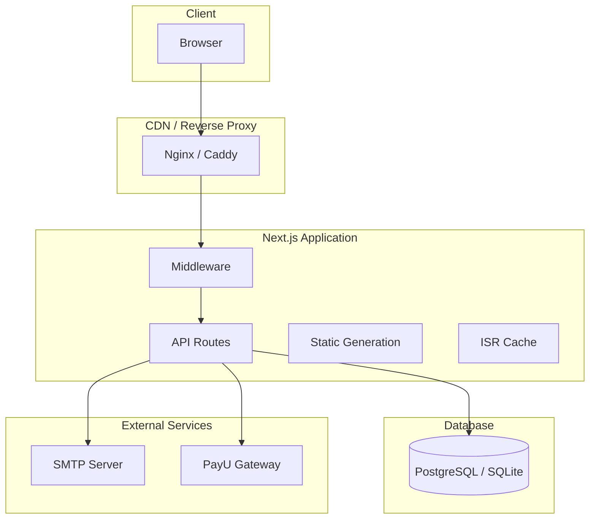
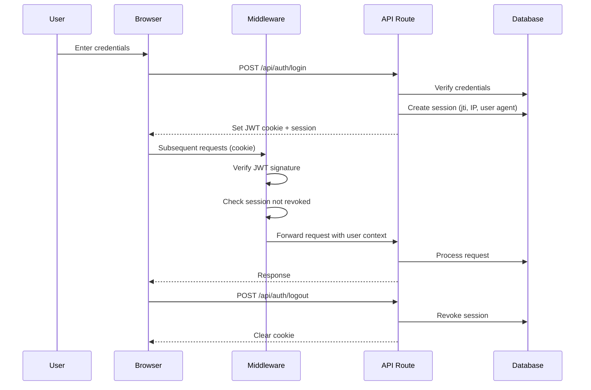
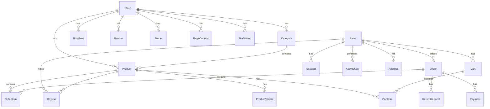
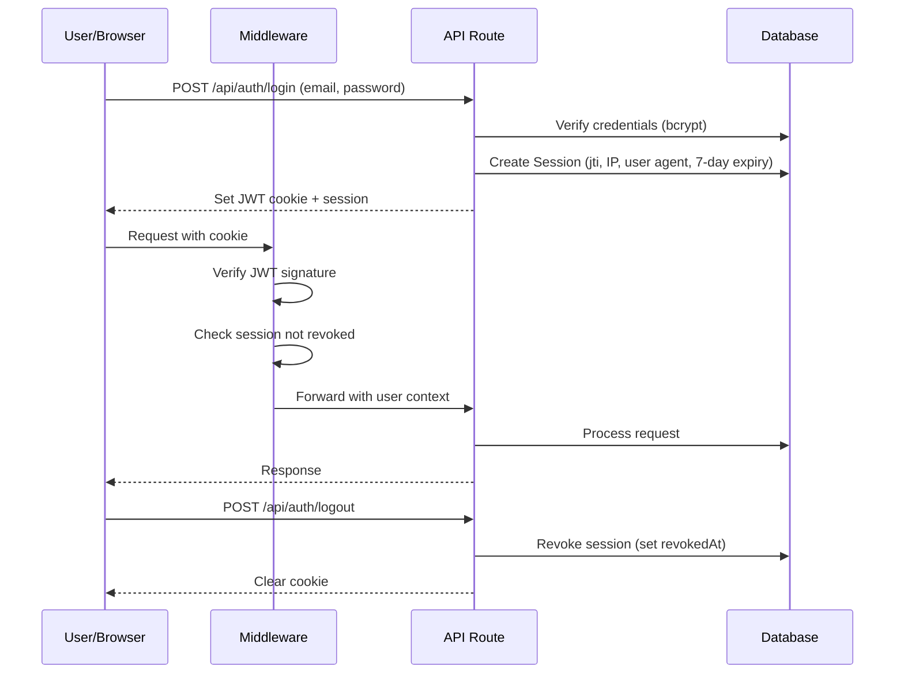
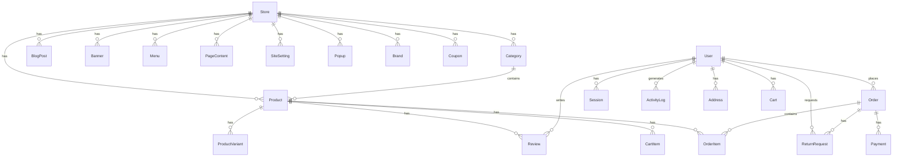
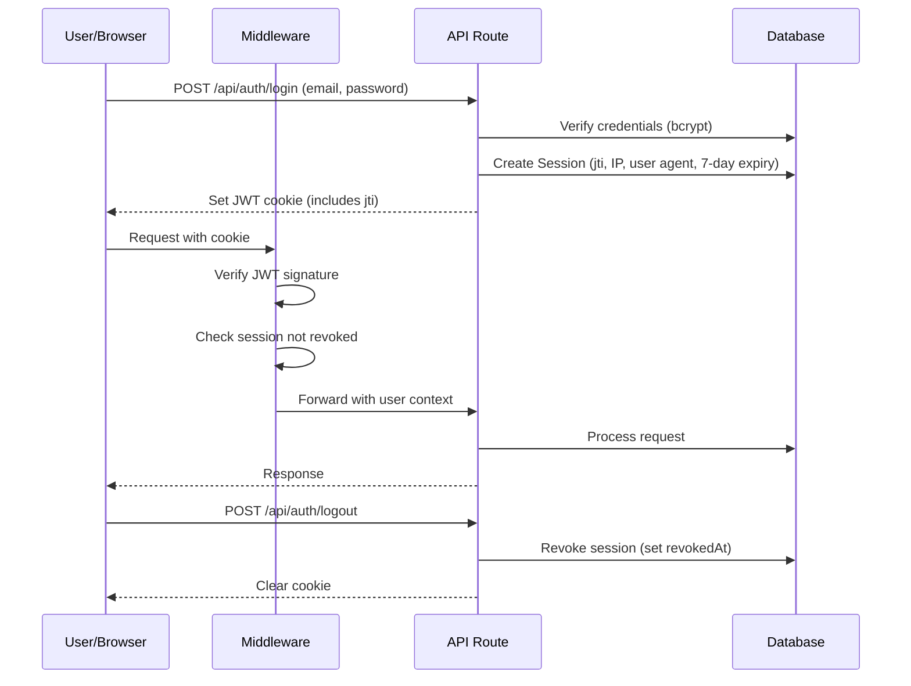
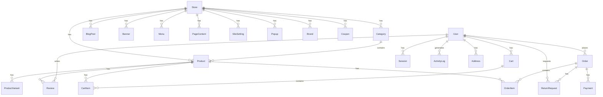
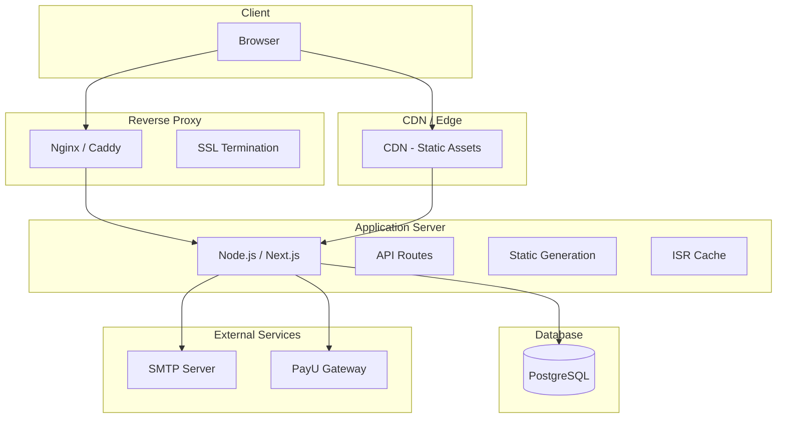
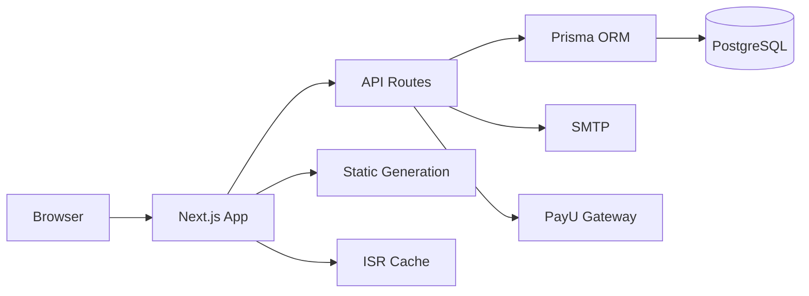

# WCommerce Catalogue — Architecture Guide

## System Architecture



## Authentication Flow



## Database ER Diagram



## Authentication Flow



## Database ER Diagram



## Authentication Flow



## Deployment Architecture

```mermaid
graph TB
    subgraph "Production Environment"
        subgraph "Client"
            B[Browser]
        end

        subgraph "CDN / Edge"
            CDN[CDN - Static Assets]
        end

        subgraph "Reverse Proxy"
            RP[Nginx / Caddy]
            SSL[SSL Termination]
        end

        subgraph "Application Server"
            NODE[Node.js / Next.js]
            API[API Routes]
            SSG[Static Generation]
            ISR[ISR Cache]
        end

        subgraph "Database"
            PG[(PostgreSQL)]
        end

        subgraph "External Services"
            SMTP[SMTP Server]
            PAYU[PayU Gateway]
        end

        B[Browser] --> CDN
        B --> RP
        RP --> NODE
        NODE --> PG
        NODE --> SMTP
        NODE --> PAYU
        CDN --> NODE
```

## Authentication Flow


## Database ER Diagram



## Authentication Flow


## Deployment Architecture



## Key Design Decisions

### Single-Store Architecture

This is a **single-store** B2B/B2C catalogue application. The `Store` model and `DEFAULT_STORE_SLUG` resolution exist only to identify the one operating store. Multi-tenancy (subdomain routing, custom domains, store switching) is intentionally out of scope.

### Session-Based Authentication

Authentication uses JWT tokens with server-side session tracking:
- JWT includes a `jti` (JWT ID) for token-level revocation
- Sessions are stored in the database with IP, user agent, and 7-day expiry
- Admins can list and revoke active sessions
- Logout revokes the session server-side

### API Design

- All endpoints under `/api/*` (no version prefix yet)
- Standardized response format via `src/lib/api-response.ts` (`{ success, data }` / `{ success, error }`)
- OpenAPI 3.0 spec served at `GET /api/docs`
- Rate limiting on critical endpoints (login, contact, newsletter, orders, products)
- Pagination via cursor-based (`?cursor=`) and page-based (`?page=&limit=`) patterns

### Data Flow



## Key Design Decisions

### Why SQLite is Default (Dev) and PostgreSQL is Recommended (Prod)

- **SQLite**: Zero configuration, file-based, ideal for development and testing
- **PostgreSQL**: Concurrent writes, connection pooling, `@check` constraints, better scalability
- The project ships both `prisma/schema.prisma` (SQLite) and `prisma/schema.postgres.prisma` (PostgreSQL)

### Session Management

- JWT tokens include a `jti` (JWT ID) for token-level revocation
- Sessions stored in database with IP, user agent, 7-day expiry
- Admins can list and revoke active sessions
- Logout revokes the session server-side

### API Response Contract

All API responses follow a standardized format:

```typescript
// Success
{ success: true, data: T, message?: string, pagination?: PaginationMeta }

// Error
{ success: false, error: string, code?: string, details?: unknown }
```

### Caching Strategy

- **ISR**: Product pages use Incremental Static Regeneration
- **API Cache**: Public read endpoints (`/api/products`, `/api/categories`, `/api/blog`, etc.) have `s-maxage=60, stale-while-revalidate=300`
- **Browser Cache**: Static assets (`_next/static`) have 365-day cache with immutable flag
- **No Redis yet**: Data caching layer is a future enhancement
